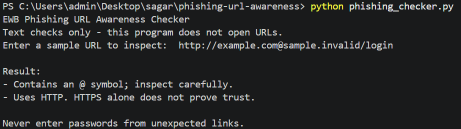
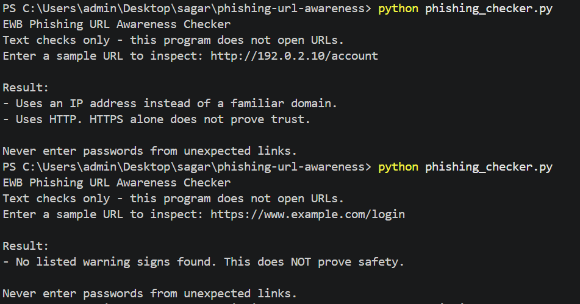

# EWB Phishing URL Awareness Checker

## Overview
Phishing is a deceptive technique where attackers use fake links or messages to steal sensitive information such as passwords or credit card numbers. This tool is a command-line Python program that inspects a given URL's text for common, visible warning signs of phishing without ever visiting or interacting with the website.

## Features
- Detects an @ symbol in the URL
- Flags unusually long URLs (over 100 characters)
- Flags IP-address hostnames
- Flags many hostname segments (5 or more)
- Flags punycode-style hostnames (xn--)
- Flags the HTTP scheme
- Allows checking multiple URLs continuously using a loop
- Safely handles malformed inputs without crashing

## Requirements
Python 3.10 or later. No extra packages.

## How to Run
Windows: `python phishing_checker.py`
Mac/Linux: `python3 phishing_checker.py`

## Example Output
```text
EWB Phishing URL Awareness Checker
Text checks only - this program does not open URLs.

Enter a sample URL (or type q to quit): http://192.0.2.10/account

Result:
- Uses an IP address instead of a familiar domain.
- Uses HTTP. HTTPS alone does not prove trust.

Never enter passwords from unexpected links.
```

## Testing
|#| Input | Expected Result | Actual Result | Pass/Fail |
|---|---|---|---|---|
| 1 | https://www.example.com/login | No warning signs | No listed warning signs found. This does NOT prove safety. | PASS |
| 2 | http://192.0.2.10/account | IP address + HTTP | Uses an IP address instead of a familiar domain.<br>Uses HTTP. HTTPS alone does not prove trust. | PASS |
| 3 | http://example.com@sample.invalid/login | @symbol + HTTP | Contains an @ symbol; inspect carefully.<br>Uses HTTP. HTTPS alone does not prove trust. | PASS |
| 4 | https://a.b.c.d.e.example.invalid/path | Many hostname segments | Contains many hostname segments/subdomains. | PASS |
| 5 | https://xn--example.invalid/ | Punycode-style hostname | Contains a punycode-style hostname. | PASS |

## Screenshots



## Improvements
1. **Loop with quit command**: Wrapped the main prompt inside a `while True` loop so multiple URLs can be checked in one session. Added logic to break the loop if the user types `q`, `quit`, or `exit`. Tested by entering multiple URLs consecutively and then successfully exiting with `q`.
2. **Stop crashes on malformed input**: Wrapped the `parsed = urlparse(candidate)` logic in a `try/except ValueError` block. This prevents Python from crashing when a structurally broken URL (like `http://[bad`) is entered. Tested by inputting malformed text to ensure the program prints a safe error message ("This text is not a valid URL format.") and continues running.

## Limitations
This is an educational tool. It only reads URL text. It does not visit URLs, scan for malware or prove that a URL is safe. No warning signs found does NOT mean a URL is safe.

## Ethical Use
Use sample strings only. Do not collect credentials. Do not use this project to deceive anyone or to test websites without permission.

## Author
Sagar Santosh Yadav, Data Science, EWB Courses